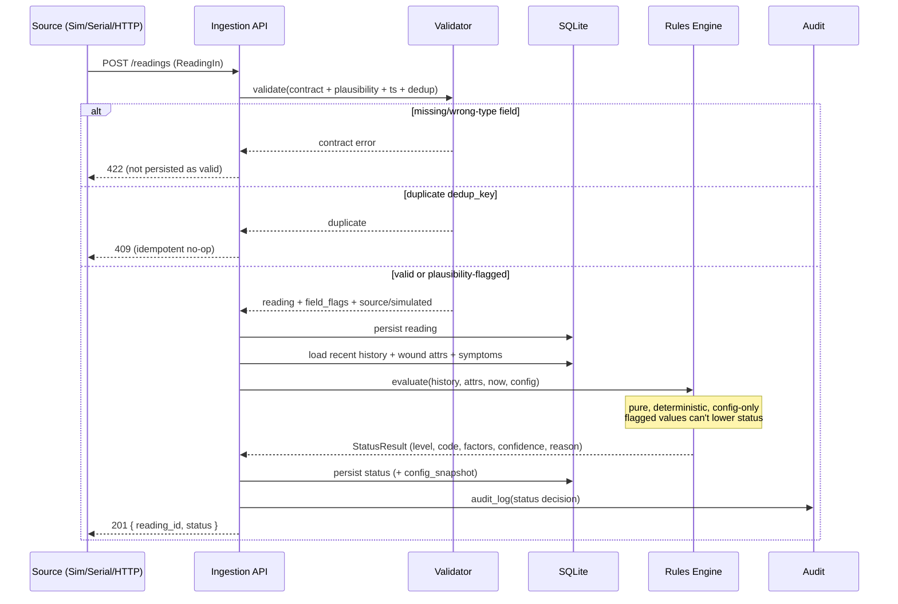

# Design — Safety Core and Data Pipeline

## Overview

This design realizes the P0 backend slice: a FastAPI + SQLite service that ingests bandage readings
through a pluggable `DataIngestion` interface, validates them against a strict contract, persists
them, runs a **deterministic** rules engine to produce a wound status, and exposes a light-dose
request endpoint whose caps are enforced entirely in backend code from config.

Design principles pulled from steering:

- Safety is deterministic backend code. The rules engine and dose enforcement are pure functions of
  (readings + attributes + config). No LLM/ML, no network, no caller-supplied thresholds.
- Honesty over reassurance: stale/invalid/simulated data is surfaced, never masked. Absent usable
  data yields `unknown`, not `normal`.
- Config-driven: all clinical numbers in `config/clinical_thresholds.yaml` (placeholders), all dose
  caps in `config/safety_limits.yaml`. Fail safe if missing/unparseable.
- Public repo: no secrets, synthetic data only.

## Technology choices

- **Backend:** Python 3.11+, FastAPI (ASGI, built-in OpenAPI, Pydantic v2 validation).
- **DB:** SQLite via SQLAlchemy 2.x (file for dev, in-memory for tests). WAL mode + a per-wound lock
  for dose-request serialization (Req 11).
- **Validation:** Pydantic models for the wire contract; a separate domain validator for
  range/plausibility flagging (so "schema-valid but implausible" is distinct from "malformed").
- **Config:** PyYAML, loaded once at startup into immutable dataclasses; a config snapshot id (hash)
  is recorded with every decision for auditability (Req 13).
- **Tests:** pytest. Simulator uses a seeded RNG for reproducibility.
- **Serial bridge:** `pyserial`, a standalone script (not part of the API process) that reads lines
  and POSTs to the ingestion endpoint.

## Architecture

```
                        config/clinical_thresholds.yaml
                        config/safety_limits.yaml
                                   |
                                   v  (loaded once, snapshot-hashed)
 SimulatorSource  \         +--------------+       +---------------+
 SerialBridge      >--POST--> ingestion API +-----> validation     |
 HttpDevice       /         |  (FastAPI)   |       | (contract +   |
                            +------+-------+       |  plausibility)|
                                   |               +-------+-------+
                                   v                       |
                            +--------------+               v
                            |  SQLite DB   | <--- persist flagged/clean reading
                            | devices,     |
                            | wounds,      |               |
                            | readings,    |               v
                            | statuses,    |        +--------------+
                            | dose_requests|<-------+ rules engine  |  (pure, deterministic)
                            | audit        |  status | status + red |
                            +------+-------+         | flags+trends |
                                   |                 +--------------+
                                   v
                   status / timeline / dose-request endpoints  --> (frontend, later)
```

### Module layout

```
backend/
  app/
    main.py                 # FastAPI app, routes, DI wiring
    api/
      readings.py           # POST /readings, POST /readings/batch
      status.py             # GET /wounds/{wound_id}/status, /timeline
      dose.py               # POST /wounds/{wound_id}/dose-requests
    core/
      config.py             # load + validate YAML, snapshot hash, fail-safe
      models_db.py          # SQLAlchemy models
      schemas.py            # Pydantic wire models (Reading, Status, DoseRequest...)
      db.py                 # engine/session, WAL, migrations-lite
    ingestion/
      base.py               # DataIngestion interface (Protocol/ABC)
      validator.py          # contract + plausibility + dedup + ts checks
      simulator.py          # SimulatorSource + scenarios
      serial_bridge.py      # SerialBridge (reads serial -> POST)  [script entry]
      http_device.py        # HttpDevice (thin client/doc of the POST path)
    safety/
      rules.py              # status levels, pure evaluate(history, attrs, cfg)
      red_flags.py          # red-flag rules, each independently testable
      trends.py             # trend-window computation, insufficient_data
      staleness.py          # freshness + sensor-health + reduced confidence
      dose.py               # dose cap enforcement (dose/session/gap/cumulative)
      audit.py              # persist decision records
  tests/
    test_validation.py
    test_rules_status.py
    test_red_flags.py       # one test per red flag (Req 6.5)
    test_trends.py
    test_staleness.py
    test_dose_caps.py       # one test per cap (Req 9.8)
    test_dose_concurrency.py
    test_simulator.py
    test_config_failsafe.py
    test_threshold_injection.py
    test_api_e2e.py         # reading -> status round trip per scenario
config/
  clinical_thresholds.yaml
  safety_limits.yaml
scripts/
  run_serial_bridge.py
  run_simulator.py          # feed a scenario into the API for the demo
.env.example
```

## Data models

### Wire contract (Pydantic) — `ReadingIn`

| field          | type    | notes                                                        |
|----------------|---------|--------------------------------------------------------------|
| device_id      | str     | required                                                     |
| wound_id       | str     | required                                                     |
| ts             | datetime| ISO-8601 UTC; future-beyond-skew → `invalid_timestamp`       |
| ph             | float   | plausible 0–14 (from config)                                 |
| skin_temp_c    | float   | plausible range from config                                  |
| moisture_pct   | float   | plausible 0–100                                              |
| battery_pct    | float   | plausible 0–100                                              |
| sensor_status  | enum    | ok \| drifting \| disconnected (else → disconnected + warn)  |

Server-added fields on persist: `source` (simulator|serial|http), `simulated` (bool),
`field_flags` (per-field: ok|out_of_range|invalid_timestamp), `received_at`, `dedup_key`
(`device_id|wound_id|ts`).

### DB schema (SQLAlchemy)

- **devices**(device_id PK, label, created_at)
- **wounds**(wound_id PK, device_id FK, body_site, depth_type, created_at,
  attr_diabetic BOOL NULLABLE, attr_immunocompromised BOOL NULLABLE, ...)  — nullable = `unknown`
- **reported_symptoms**(id, wound_id FK, ts, kind {spreading_redness,pus,fever,severe_pain,
  rapid_worsening,bite_puncture,...}, present BOOL, note)  — feeds red flags
- **readings**(id, device_id, wound_id, ts, ph, skin_temp_c, moisture_pct, battery_pct,
  sensor_status, source, simulated, field_flags JSON, received_at, UNIQUE(dedup_key))
- **statuses**(id, wound_id, computed_at, from_reading_id, level, machine_code, data_level,
  sensor_health, stale BOOL, factors JSON, reason_text, config_snapshot)
- **dose_requests**(id, wound_id, requested_at, requested_params JSON, outcome {granted,denied},
  enforced_limits JSON, reason, granted_params JSON NULL, config_snapshot)
- **audit_log**(id, ts, kind {status,dose}, wound_id, payload JSON) — Req 13

### Status result (Pydantic) — `StatusOut`

```
{
  "wound_id": "A-204",
  "level": "watch",                 # normal|watch|infection-risk|escalate
  "machine_code": "WATCH_PH_RISING",
  "data_level": "watch",            # data-driven level, may be "unknown"
  "red_flags": ["..."],             # active red flags (force escalate)
  "sensor_health": "ok",            # ok|drifting|disconnected
  "stale": false,
  "simulated": true,
  "trend": {"ph": "rising", "temp": "steady", "status": "ok|insufficient_data"},
  "confidence": "normal|reduced",
  "reason": "plain-language explanation naming the driving factor(s)",
  "last_updated": "2026-...Z",
  "config_snapshot": "sha256:..."
}
```

## OpenAPI contract (summary)

Full generated spec is served at `/openapi.json` by FastAPI; this is the designed contract.

```yaml
openapi: 3.0.3
info:
  title: Sushruta Safety Core & Data Pipeline
  version: 0.1.0
  description: >
    P0 backend. Deterministic safety. Proof of concept, NOT a medical device.
paths:
  /health:
    get:
      summary: Liveness + config load status (fail-safe indicator)
      responses:
        "200": { description: OK, config loaded }
        "503": { description: Safety config missing/unparseable; decisions refused }

  /readings:
    post:
      summary: Ingest one reading
      requestBody:
        required: true
        content:
          application/json:
            schema: { $ref: "#/components/schemas/ReadingIn" }
      responses:
        "201": { description: Stored; returns reading id + computed status }
        "409": { description: Duplicate (same device/wound/ts) — idempotent no-op }
        "422": { description: Contract violation (missing/wrong-type fields) }
        "503": { description: Datastore or safety config unavailable }
  /readings/batch:
    post:
      summary: Ingest many readings (array)
      responses:
        "207": { description: Per-item results (stored/duplicate/invalid) }

  /wounds/{wound_id}/status:
    get:
      summary: Current deterministic status (incl. stale/sensor/simulated/confidence)
      responses:
        "200": { description: StatusOut }
        "404": { description: Unknown wound }
  /wounds/{wound_id}/timeline:
    get:
      summary: Time-ordered reading + status history
      parameters:
        - { name: from, in: query, schema: { type: string, format: date-time } }
        - { name: to,   in: query, schema: { type: string, format: date-time } }
        - { name: limit, in: query, schema: { type: integer, default: 200 } }
      responses:
        "200": { description: Array of readings/statuses ordered by ts }

  /wounds/{wound_id}/dose-requests:
    post:
      summary: REQUEST a 405nm light session (backend enforces hard caps)
      requestBody:
        content:
          application/json:
            schema: { $ref: "#/components/schemas/DoseRequestIn" }
      responses:
        "201": { description: Granted; returns granted_params + next-allowed time }
        "409": { description: Denied; returns enforced limit + reason (gap/dose/escalate) }
        "503": { description: Safety config unavailable }

components:
  schemas:
    ReadingIn:
      type: object
      required: [device_id, wound_id, ts, ph, skin_temp_c, moisture_pct, battery_pct, sensor_status]
      properties:
        device_id:     { type: string }
        wound_id:      { type: string }
        ts:            { type: string, format: date-time }
        ph:            { type: number }
        skin_temp_c:   { type: number }
        moisture_pct:  { type: number }
        battery_pct:   { type: number }
        sensor_status: { type: string, enum: [ok, drifting, disconnected] }
      additionalProperties: false      # Req 14: unknown fields ignored, cannot inject thresholds
    DoseRequestIn:
      type: object
      properties:
        requested_dose_mj:      { type: number }   # a REQUEST only
        requested_duration_s:   { type: number }
      additionalProperties: false      # Req 14: no cap/threshold/override fields honored
```

> Note (Req 14): `additionalProperties: false` plus explicit allow-lists means no caller can supply
> a threshold, cap, or forced status. The server never reads limits from the request body.

## Deterministic rules engine design

`safety.rules.evaluate(history, attrs, now, config) -> StatusResult` — pure, no I/O.

Pipeline inside `evaluate`:

1. **Select usable readings**: drop field values flagged `out_of_range`/`invalid_timestamp` from
   any computation that could *lower* status (Req 1.3, 12.1). Determine freshness vs
   `config.freshness_window` (Req 8).
2. **Data-driven level** from latest usable reading + trends:
   - `trends.compute(history, window)` → direction/magnitude per metric or `insufficient_data`.
   - Compare against `clinical_thresholds` watch/infection-risk bands.
   - If no usable fresh reading → `data_level = unknown` (Req 12.2), never `normal`.
3. **Red flags** via `red_flags.evaluate(attrs, symptoms, trends, config)` → list. Any present ⇒
   candidate level `escalate` (Req 6.2). `unknown` attributes handled conservatively per config,
   never downgraded (Req 6.4).
4. **Combine**: `level = max_severity(data_level_mapped, escalate_if_red_flags)`; escalation only
   raises (Req 5.6). `unknown` data level does not produce a reassuring result.
5. **Confidence**: `reduced` if stale, sensor `drifting`/`disconnected`, or low battery coincides
   with drift (Req 8.3, 12.3).
6. **Explain**: build machine_code + plain reason naming the driving factor(s) (Req 5.8/5.9);
   escalate messages always advise seeking care, never discourage (Req 6.3).

Level ordering helper: `normal(0) < watch(1) < infection-risk(2) < escalate(3)`.

## Dose enforcement design

`safety.dose.decide(wound_id, request, history_of_grants, status, config, clock) -> DoseDecision`,
executed under a **per-wound lock** inside a DB transaction (Req 11).

Checks, in order, all deny-closed:

1. Config loaded? else 503 fail-safe (Req 10.5).
2. Status `escalate` or active red flag ⇒ deny, direct to care (Req 9.5).
3. `requested_dose_mj > max_dose` or `requested_duration_s > max_session_s` ⇒ deny with limit
   (Req 9.3; no silent clamp unless config `clamp: true`).
4. Time since last granted session `< min_gap_s` ⇒ deny with remaining time (Req 9.4).
5. Cumulative/daily cap exceeded ⇒ deny (Req 9.8).
6. Else grant: persist granted params + timestamp (Req 9.6) within the same transaction so a racing
   request sees the committed grant (Req 11.2).

## Sequence: reading → validation → rules → status



## Simulator design

`SimulatorSource(scenario, seed)` yields `ReadingIn`-shaped dicts marked `simulated=true`.

- Each scenario is a trajectory generator over configurable duration/interval with seeded noise.
- `healing`: pH drifts toward neutral, temp normal, moisture decreasing → stays `normal`.
- `early_infection`: pH rises + temp climbs across the trend window → crosses to `infection-risk`
  (Req 3.5).
- `heavy_exudate`: moisture high/climbing → `watch`.
- `inflammation_spike`: temp spike + pH rise over window → `infection-risk`.
- `sensor_dropout`: emits gaps and `sensor_status` drifting/disconnected → exercises staleness
  (Req 3.3).
- Fixed seed ⇒ identical sequence (Req 3.4), enabling deterministic e2e tests.

`scripts/run_simulator.py --scenario early_infection --seed 1 --post http://localhost:8000`
drives the demo by POSTing readings on an interval.

## Config design

`config/clinical_thresholds.yaml` (every value tagged placeholder):

```yaml
# PLACEHOLDER: verify with literature/clinician
plausible:
  ph: {min: 0.0, max: 14.0}
  skin_temp_c: {min: 20.0, max: 45.0}
  moisture_pct: {min: 0.0, max: 100.0}
  battery_pct: {min: 0.0, max: 100.0}
freshness_window_s: 1800            # PLACEHOLDER
clock_skew_tolerance_s: 300
low_battery_pct: 15                 # PLACEHOLDER
trend_window_s: 86400               # PLACEHOLDER
ph:
  watch_above: 7.6                  # PLACEHOLDER
  infection_risk_above: 8.0         # PLACEHOLDER
skin_temp_c:
  watch_above: 34.0                 # PLACEHOLDER
  infection_risk_above: 35.5        # PLACEHOLDER
moisture_pct:
  watch_above: 70                   # PLACEHOLDER
no_improvement_days: 5              # PLACEHOLDER  (N)
unknown_attr_policy: conservative   # conservative => don't downgrade
```

`config/safety_limits.yaml`:

```yaml
dose:
  max_dose_mj: 100                  # PLACEHOLDER
  max_session_s: 120                # PLACEHOLDER
  min_gap_s: 14400                  # PLACEHOLDER (4h)
  max_daily_sessions: 3             # PLACEHOLDER
  clamp: false                      # deny over-limit, don't silently clamp
  block_on_escalate: true
```

Loader computes `sha256` over the parsed config → `config_snapshot` recorded on every decision.
Missing/unparseable safety config ⇒ `/health` 503 and decision endpoints 503 (Req 10.5).

## Error handling & fail-safe summary

- Contract violation → 422; plausibility → persist flagged, don't let it lower status.
- Duplicate → 409 idempotent.
- DB down → 5xx, never success (Req 4.5).
- Safety config missing/bad → 503 on dependent endpoints (Req 10.5).
- No usable fresh data → status `unknown` + reduced confidence, never `normal`.
- All dose checks deny-closed.

## Testing strategy (maps to tasks)

- Unit: validator, each red flag (one test each), trend windows incl. `insufficient_data`,
  staleness/simulated labelling, each dose cap (one test each), concurrency, config fail-safe,
  threshold-injection no-op, simulator reproducibility.
- Integration/e2e: run each simulator scenario through the real API and assert the expected status
  trajectory (healing→normal, early_infection→infection-risk, dropout→stale/reduced confidence).
- Honesty check feeding `docs/accuracy.md`: tests prove logic, not clinical accuracy.
