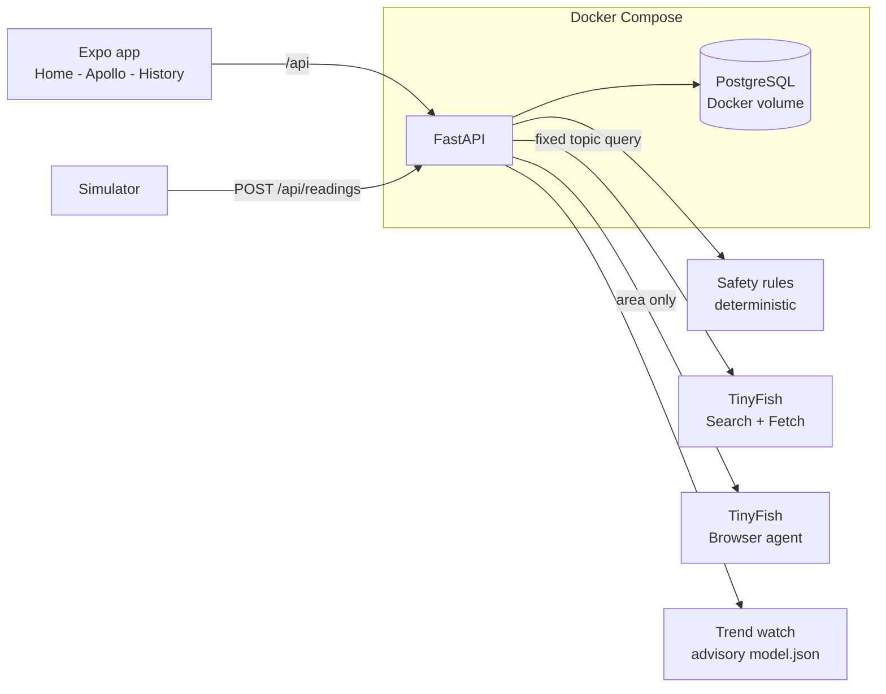

# Sushruta

Sushruta is a Hindi- and English-friendly companion app for a future smart wound patch, with an assistant called **Apollo**. It shows simulated pH, skin temperature and moisture readings, turns them into a plain-language safety status, keeps the full reading history, and lets patients and caregivers ask wound-care questions that are answered from live, trusted health websites.

Built for AzinHack 2026 (USAR, GGSIPU) by Team Sushruta. Sponsors: **TinyFish** and **Docker**.

> **Not a medical device.** Sushruta does not diagnose, prescribe, or replace a clinician. All clinical thresholds are placeholders awaiting clinician review. Readings are simulated; no real patch is connected.

## What works today

| Feature | Status |
| --- | --- |
| Home: simulated pH, temperature, moisture, battery and a safety status | Working |
| History tab: every stored reading, charts, status counts | Working |
| Deterministic safety rules (no AI involved) | Working, tested |
| Apollo chat: live answers from trusted sites via **TinyFish Search + Fetch** | Working. Needs `TINYFISH_API_KEY`; falls back to saved notes without it |
| Find care nearby: a **TinyFish browser agent** looks up clinics on a map | Working in tests and one real run. Needs `TINYFISH_API_KEY` |
| TinyFish activity log inside the app | Working |
| Trend watch: experimental ML early-warning score (synthetic data) | Working, advisory only. See `ml/MODEL_CARD.md` |
| Hindi / English, three text sizes, read-aloud (device voice) | Working. Hindi wording needs a native reader's review (`docs/hindi-review.md`) |
| Docker Compose (Postgres + API) | Included. Not run inside Replit; needs a machine with Docker |
| Voice input, document scanning (OpenCV + Google Cloud Vision), care report | **Not built yet** |

## Where the data comes from (and where it does not)

- **Readings are simulated.** A simulator posts a reading to the same `POST /api/readings` endpoint a real patch would use. No real patient data exists in this project.
- **There is no model training on patient data.** The safety status comes from rules, on purpose: a rule can be tested and explained, and there is no clinical dataset to train on responsibly.
- **One small experimental model exists** (Trend watch). It is trained on synthetic data we generate, is advisory only, and never changes the safety status. Full pipeline, numbers and limits: `ml/MODEL_CARD.md`.

## How Apollo stays safe

1. **Rules first.** Red-flag words in the question (spreading redness, pus, fever, severe pain, rapid worsening, deep wound, bite, diabetes, weak immunity) and a "see a doctor today" patch status trigger a fixed escalation message with a Call button. Nothing downstream can soften or remove it.
2. **TinyFish fetches the facts.** Apollo sends one fixed, generic topic query (for example "signs of wound infection"). Your message and readings are never sent to TinyFish. Only pages from an allow-list (`config/trusted_domains.json`: NHS, WHO, CDC, MedlinePlus, NICE, Mayo Clinic) are used.
3. **No language model writes the answer.** Apollo picks the sentences from the fetched pages that best match the question (scored on the server, so the question goes nowhere else) and shows them as cited bullets. Urgency headings are relabelled ("See a doctor soon if:") and sentences naming UK-only emergency numbers are dropped, because the sources are often UK pages. If nothing relevant is found, Apollo says it isn't sure.
4. **Fallbacks.** Fresh cache (6 hours), then live fetch, then older cache, then saved offline notes (`knowledge/topics.json`). The app says which one it used.
5. **Every TinyFish call is logged** to the `tinyfish_calls` table and visible in the app (tap the TinyFish logo under an answer).

## How we use TinyFish

| TinyFish product | What Sushruta does with it | Where |
| --- | --- | --- |
| Search | Finds trusted pages for a fixed topic query | `backend/tinyfish.py` `search`, `backend/apollo.py` |
| Fetch | Reads those pages as clean text | `backend/tinyfish.py` `fetch` |
| **Agent (browser)** | Opens a map site in a real browser, reads clinic names, addresses, phones and hours | `backend/tinyfish.py` `agent_start/agent_status`, `backend/care_finder.py` |

The only thing the agent receives is the area the user types for that request, cleaned to plain letters and digits. Its output is treated as untrusted text: length-limited, shown as plain text, and never fed to a model.

## Where Docker fits

PostgreSQL stores the patient's reading history. Docker Compose runs the API and PostgreSQL together, and a **named Docker volume (`postgres_data`) keeps the history between restarts**. So the stack is identical on any machine, and a clinician-facing deployment keeps its records. Docker itself is the packaging and runtime. The database is what stores the history.

## Architecture



## Stack

| Area | Technology |
| --- | --- |
| Mobile | Expo (SDK 57), React Native, TypeScript, Expo Router, React Query, i18next, react-native-svg |
| API | Python 3.11, FastAPI, Pydantic, HTTPX |
| Data | PostgreSQL, SQLAlchemy, Alembic |
| Live guidance + agent | **TinyFish** Search, Fetch and Agent APIs |
| ML (offline training) | scikit-learn, NumPy (not needed at run time) |
| Packaging | **Docker** and Docker Compose |
| Tests | pytest (88 tests) |

## Repository map

```
backend/        FastAPI app: routes, safety rules, simulator, Apollo, TinyFish client, care finder, trend
backend/migrations/   Alembic migrations (readings, TinyFish log, cache)
artifacts/sushruta/   Expo app (app/(tabs): index = Home, apollo, history)
config/         clinical_thresholds.json (placeholders), trusted_domains.json
knowledge/      offline notes in English and Hindi (used when TinyFish is unavailable)
ml/             synthetic data generator, features, training script, model.json, MODEL_CARD.md
tests/          pytest suites
docs/           accuracy notes, Hindi review list
```

## Run it

### Replit

1. Add the secret `TINYFISH_API_KEY` (Tools, then Secrets; get the key at [agent.tinyfish.ai/home](https://agent.tinyfish.ai/home)).
2. Start the API workflow. It runs `alembic upgrade head` and then FastAPI on port 8080.
3. Start the Expo workflow. Open the app in its own browser tab or in Expo Go. Replit's small embedded preview pane can fail to reach the API because of third-party cookie rules.

### Docker

```sh
cp .env.example .env     # then paste your TinyFish key (optional)
docker compose up --build
```

The API is at `http://localhost:8080/api`. Compose starts PostgreSQL, waits for it to be healthy, applies the migrations, then runs FastAPI. The Docker files have not been run inside Replit, which cannot run Docker.

### Retrain the trend model (optional)

```sh
pip install -r ml/requirements.txt
python -m ml.generate_data
python -m ml.train
```

### Environment variables

| Variable | Needed | Purpose |
| --- | --- | --- |
| `DATABASE_URL` | Yes | PostgreSQL connection string |
| `TINYFISH_API_KEY` | For live guidance and Find care | Server-side only; used for Search, Fetch and Agent |

## API

- `GET /api/healthz`: health check
- `POST /api/readings`, `GET /api/readings/latest`, `GET /api/status`: ingestion, latest reading, safety status
- `GET /api/readings/history`: stored readings, oldest first, with status counts
- `GET /api/trend`: experimental advisory trend score (never changes the status)
- `POST /api/simulator/scenario`: create a simulated reading
- `POST /api/apollo/chat`: ask Apollo a question `{message, language}`
- `POST /api/apollo/find-care`: TinyFish browser agent looks up clinics near `{area}`
- `GET /api/tinyfish/activity`: recent TinyFish calls
- `GET /api/apollo/health`: which integrations are configured (booleans only, never keys)

## Demo script

1. Home: normal status. Use a simulator scenario such as early infection and watch the status change to see-a-doctor.
2. History: show the stored readings and the experimental Trend watch.
3. Apollo: tap "Is it infected?" and watch live sources appear. Tap a source chip, then the TinyFish logo to see the exact query that was sent.
4. Type "there is pus and fever": the escalation box and Call button appear before any answer.
5. Tap "Find care nearby", type your area, and watch the TinyFish browser agent return clinics.
6. Switch to Hindi and repeat.

## Tests

```sh
pytest -q
```

## Known limits

Clinical thresholds are placeholders. The Hindi text and offline notes have not been reviewed by a clinician or a native reader. Voice input and document scanning are not built. Live Hindi answers show English source sentences under a Hindi lead-in, because no model translates them; the saved offline notes are in Hindi. Answers are extracts, so they read less smoothly than a written summary. The TinyFish Search and Fetch calls were checked against documented request shapes, and the browser agent was run once for real through the TinyFish tool; test all three with your key before the demo. The agent's start/poll calls follow the documented endpoints but their exact response fields were not confirmed against a live key.
